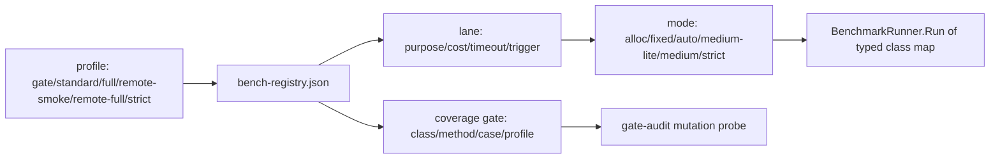

# 性能测试系统耗时优化（Stage A：归因与方案）

> 日期：2026-10-23
> HEAD：`1dce4d4`（分支 `dev`，工作树干净）
> 机器：Windows 10 x64，AMD Ryzen 9 8945HX（32 逻辑核），31.3 GB；.NET SDK 11.0.100-rc.2.26504.105；BDN 0.16.0-preview.2（InProcessEmitToolchain）
> 口径：本文件是 Stage A 产物。Stage A 只读归因，没有修改 `src/`、`bench/` 或 `scripts/eps-run.cs`。标 `[实测]` 的数字来自本轮命令；标 `[推断]` 的数字来自已测数据的线性外推或结构推导，未经本轮实测。
> 任务书要求的三个阶段：Stage A 归因与方案（本文件），Stage B 实施（待批准），Stage C 验证与交付。

## 0. 结论摘要

本地 17 条车道的基线是 5,132 秒，约 85.5 分钟。时间不在产品代码里，主要在四个地方：

1. BDN 的每方法采样预算与宿主开销。微基准车道每条方法约 40 秒，其中真正计入结果的测量只占 11% 到 48%，其余是预热、Pilot、Jitting、报告与进程内重复启动 `[实测，见 §3]`。
2. 投递车道的慢格。`delivery` 906 秒中，RTT 大于 0 且 InFlight=1 的四格贡献约 543 秒测量时间，另有约 259 秒花在每迭代清场重灌 1000 条 `[实测，见 §3.2]`。
3. 重复执行。`infra` 里包含 `CompressionBenchmarks` 与 `SqlGenBenchmarks`，`compression` 与 `sqlgen` 车道又各跑一次，重复成本约 503 秒 `[实测，见 §3.5]`。
4. 远程车道的失败成本。2026-10-23 全量运行中 `persist-mysql` 撞 90 分钟上限，单车道浪费 5,430 秒，另加 30 秒退避与一次 1,263 秒的 `persist-pg` 重跑 `[实测，见 §3.6]`。

方案采用注册表驱动的车道与 profile 重设计，而不是继续给每条车道写 bespoke config。核心是把测量分成四种用途：分配判定、趋势、参考、严格。分配判定用低采样档，趋势用 9 到 14 次执行的小档，参考保留 MediumRun，严格保留 40/20/3。每一类用实测 Error/Mean 选择档位，超过 15% 的类退回 MediumRun，不搞一刀切。

按已测探针外推，本地 `--full` 从 85.5 分钟降到约 26 分钟（投递保持 906 秒不降采样）；如果投递夹具摊销验证通过，约 23 分钟。`--full --include-remote` 在环境健康时约 63 分钟，远程环境错误时预检 10 秒内失败。常规 `standard` 档约 8.6 分钟，`--quick` 与 `--smoke` 不变。

Stage C 实测（HEAD `c3ac700`，详见 §12）：本地 `--full` **1,699 秒（28.3 分钟）**，固定档 compression 的最终组合 **1,794 秒（29.9 分钟）**；`standard` **592 秒（9.9 分钟）**；`--full --include-remote` 健康组合 **4,904 秒（81.7 分钟）**，按最终 fixed compression 组合为 **4,999 秒（83.3 分钟）**；远程环境错误 1–3 秒退出 2。投递夹具摊销 A/B 为 896 秒 vs 906 秒，无收益，已撤销；投递保持 5/3/1。

不删类、不删方法、不删参数格、不降 smoke 断言。38 个类、154 个平坦方法、173 个实际 case 全部保留归属。

## 1. 基线复核

### 1.1 事实底座

| 项 | 本轮复核 | 来源 |
| --- | --- | --- |
| 基准类 | 38 | `--list flat` 的类去重计数 |
| 平坦方法 | 154 | `dotnet run -c Release --no-build --project bench/PalDDD.Benchmarks -- --list flat`，退出码 0 |
| 实际 case | 173 | 154 个方法，其中 3 个参数化类展开为 12+4+6 格 |
| 本地车道 | 17 | `dotnet run --no-build scripts/eps-run.cs -- --list` |
| 远程车道 | 4 | 同上，`--include-remote` 追加 |
| Release 构建 | 11.68 秒 | 本轮 `dotnet build PalDDD.slnx -c Release -v minimal`，0 警告 0 错误 |

参数只存在于三个类：`OutboxDeliveryDrainBenchmarks`（RttMs 0/1/20 × InFlight 1/16 × BatchMark 1/16 = 12 格）、`OutboxDeliveryRemoteDrainBenchmarks`（2 × 2 = 4 格）、`OutboxDeliveryRemoteAutoDrainBenchmarks`（3 × 2 = 6 格）。其余 151 个方法是单格。

### 1.2 车道基线（2026-10-23 全量，HEAD `4d993d6`）

| 车道 | 秒 | 结果 | 尝试 | 备注 |
| --- | ---: | --- | ---: | --- |
| delivery | 911 | PASS | 1 | 含 RTT=20 串行格 |
| infra | 811 | PASS | 1 | 含 compression 与 sqlgen |
| framework | 751 | PASS | 1 | 18 个微基准方法 |
| coverage | 626 | PASS | 1 | MapCommand 当时 NA |
| concurrency | 525 | PASS | 1 | 每 wave 800 条种子 |
| stream | 462 | PASS | 1 | 11 个方法 |
| compression | 389 | PASS | 1 | 与 infra 重复 |
| app | 287 | PASS | 1 | 7 个方法 |
| compare | 173 | PASS | 1 | MediatR，CAP 未启用 |
| qps | 59 | PASS | 1 | 非 BDN |
| saga | 42 | PASS | 1 | 2 个方法 |
| persist | 30 | PASS | 1 | 16 个方法 |
| persist-mark | 25 | PASS | 1 | 2 个方法 |
| sqlgen | 23 | PASS | 1 | 与 infra 重复 |
| persist-medium | 16 | PASS | 1 | persist 的子集 |
| verify-persist | 2 | PASS | 1 | 探针自检 |
| smoke | 1 | PASS | 1 | 6 项分配断言 |
| 合计 | 5,132 | 17 PASS | | 约 85.5 分钟 |

Top 6（delivery、infra、framework、coverage、concurrency、stream）合计 4,086 秒，占 79.6%。

远程全量同日 22 条车道合计 11,878 秒，约 198 分钟，20 PASS / 2 FAIL。失败项是 `persist-pg`（无环境，32 秒退出）与 `persist-mysql`（90 分钟上限截断）。`persist-pg` 单独重跑 1,263 秒通过；`persist-mysql` 按源码注释实测约 56 分钟。

### 1.3 代表车道复跑（本轮，HEAD `1dce4d4`）

| 车道 | 今日全量 | 本轮复跑 | 偏差 | 退出码 | 日志 |
| --- | ---: | ---: | ---: | ---: | --- |
| delivery | 911 | 906 | -0.5% | 0 | `bench/logs/eps-run-20261023-184641/delivery.log` |
| infra | 811 | 808 | -0.4% | 0 | `bench/logs/eps-run-20261023-190147/infra.log` |
| framework | 751 | 784 | +4.4% | 0 | `bench/logs/eps-run-20261023-191515/framework.log` |
| 合计 | 2,473 | 2,498 | +1.0% | | |

复跑与今日全量同带，环境没有系统性漂移。framework 的 +4.4% 落在文档已登记的跨轮漂移带内。

`delivery` 复跑的分配列与今日逐字节一致（2.13/2.15/2.34/2.35/2.44/2.7 MB 十二格全同）。计时列的 RTT=1 串行格从 8.3 到 9.2 秒/op 变为 5.7 到 6.6 秒/op，RTT=20 串行格稳定在 23.9 到 24.9 秒/op。前者是 Windows `Task.Delay(1)` 的定时器粒度变化，同轮内比值仍有效；后者是本轮唯一稳定的慢格成本。

## 2. Case 账本

38 个类全部有车道归属，154 个方法全部有 mode 归属，173 个 case 全部保留。

| 类 | 方法 | case | 车道 | 建议 mode |
| --- | ---: | ---: | --- | --- |
| EntityDomainEventBenchmarks | 4 | 4 | framework | auto |
| ValueObjectBenchmarks | 3 | 3 | framework | auto |
| SmartEnumBenchmarks | 4 | 4 | framework | auto |
| ValidationBenchmarks | 3 | 3 | framework | auto |
| EntityCreationBenchmarks | 4 | 4 | framework | auto |
| DispatcherBenchmarks | 3 | 3 | app | fixed |
| SerializationBenchmarks | 4 | 4 | app | auto |
| OutboxThroughputBenchmarks | 4 | 4 | infra | medium |
| InboxThroughputBenchmarks | 3 | 3 | infra | auto |
| EventLogBenchmarks | 2 | 2 | infra | medium |
| SagaStateBenchmarks | 2 | 2 | infra | auto |
| ConfigurationBenchmarks | 2 | 2 | infra | auto |
| CompressionBenchmarks | 10 | 10 | compression | auto |
| SqlGenBenchmarks | 11 | 11 | sqlgen | alloc |
| ProjectionBenchmarks | 2 | 2 | coverage | fixed |
| MessageEvolutionBenchmarks | 2 | 2 | coverage | auto |
| SpecificationBenchmarks | 3 | 3 | coverage | auto |
| EndToEndChainBenchmarks | 2 | 2 | coverage | auto |
| HostingBenchmarks | 3 | 3 | coverage | auto |
| OutboxConcurrencyInMemoryBenchmarks | 5 | 5 | concurrency | fixed-short |
| OutboxConcurrencyDapperSqliteBenchmarks | 5 | 5 | concurrency | fixed-short |
| SagaLaneBenchmarks | 2 | 2 | saga | auto |
| StreamReadBenchmarks | 11 | 11 | stream | fixed |
| DapperPersistenceBenchmarks | 6 | 6 | persist | medium |
| PalOrmPersistenceBenchmarks | 5 | 5 | persist | medium |
| EfCorePersistenceBenchmarks | 5 | 5 | persist | medium |
| OutboxMarkPathBenchmarks | 2 | 2 | persist-mark | medium |
| OutboxDeliveryDrainBenchmarks | 1 | 12 | delivery | medium-lite |
| OutboxDeliveryCadenceBenchmarks | 2 | 2 | delivery | medium-lite |
| MediatRComparisonBenchmarks | 4 | 4 | compare | auto |
| CapComparisonBenchmarks | 2 | 2 | compare（CAP opt-in） | medium |
| DapperRemoteOutboxThroughputBenchmarks | 8 | 8 | persist-pg/mysql | medium-lite |
| DapperRemoteOutboxConcurrencyBenchmarks | 5 | 5 | persist-pg/mysql | medium-lite |
| PalOrmRemoteOutboxBenchmarks | 9 | 9 | persist-pg/mysql | medium-lite |
| PgDialectFeaturesBenchmarks | 5 | 5 | persist-pg | medium-lite |
| MySqlSkipLockedShapeBenchmarks | 4 | 4 | persist-mysql | medium-lite |
| OutboxDeliveryRemoteDrainBenchmarks | 1 | 4 | delivery-pg/mysql | medium-lite |
| OutboxDeliveryRemoteAutoDrainBenchmarks | 1 | 6 | delivery-pg/mysql | medium-lite |

`persist-medium` 不是一个独立类，它只跑三个持久化类的 `Outbox_Lease_Batch100` 方法，属于 `persist` 的子集。`verify-persist` 与 `qps` 不是 BDN case，前者是探针自检，后者是固定工作量 harness。

## 3. 七桶成本归因

七个桶不是简单相加的关系，部分时间同时属于两个桶。这里的数字用于排序候选，不当作预算恒等式。

### 3.1 BDN 采样与宿主开销

`MediumRun` 的实际参数是 Warmup 10、Iteration 15、Launch 2，每个方法 50 次执行；BDN 还会做 Jitting 与 Pilot。对微基准来说，Auto 档会把每次迭代放大到目标时间（默认 500 ms），于是每个方法至少 25 秒测量加预热，再加宿主与报告开销。

| 车道 | 类墙钟 | 结果阶段 | 预热 | Pilot | 其余（Jitting/宿主/报告/第二 launch） | 其余占比 |
| --- | ---: | ---: | ---: | ---: | ---: | ---: |
| framework | 751 | 91.5 | 64.5 | 13.3 | 581.7 | 77% |
| coverage | 626 | 83.0 | 60.0 | 11.5 | 471.5 | 75% |
| concurrency | 524 | 47.0 | 32.0 | 6.3 | 439.0 | 84% |
| stream | 461 | 79.9 | 未单列 | 未单列 | 381.2 | 83% |
| compression | 482 | 54.3 | 未单列 | 未单列 | 427.9 | 89% |

`[实测]` 这些数字来自 BDN 日志的 `Global total time` 与 `Workload*` 阶段行。阶段行只覆盖日志里显式打印的部分，剩余项包含第二 launch、Jitting、宿主与报告，按差额计入。结论明确：微基准车道的墙钟不是测量工作量，采样预算是第一优先级。

### 3.2 投递车道的慢格

`delivery` 的 906 秒拆成 12 格后，四个慢格（RttMs 大于 0 且 InFlight=1）贡献约 543 秒测量时间。RTT=20 的两格各约 25 秒/op，八次执行即约 200 秒/格；RTT=1 的两格受 Windows 定时器粒度支配，本轮复跑约 5.7 到 6.6 秒/op，今日全量约 8.3 到 9.2 秒/op。

Drain 类的其余约 259 秒是 IterationSetup 的清场与重灌 1000 条，十二格共 96 次 setup，约 2.7 秒/次。这部分不是产品路径成本。

`delivery` 的 12 格当前采样是 5 迭代 / 3 预热 / 1 launch。本轮探针试过 3 迭代 / 2 预热，车道从 906 秒降到 541 秒，但 RTT=0 与中等格的 Error/Mean 达到 100% 到 343%，因为每次执行只有 30 到 90 ms，定时器与 GC 噪声被放大。结论：投递不整类降采样；慢格采样已经足够稳定（Error 1.9% 到 4.0%），快格需要 5 次以上。

### 3.3 参数矩阵

投递是唯一有参数矩阵的本地车道：12 格，其中 8 格是快格（RTT=0，或 InFlight=16），4 格是慢格。远程投递各有 4 格与 6 格。这些格子都回答具体决策，Stage B 不删格，只按类选择采样档。

### 3.4 夹具与环境

投递的清场重灌约 259 秒。并发车道的种子在基准体内，不在 IterationSetup，属于被测 wave 的一部分，不能移到夹具；它的 `SeedOnly_800` 是减法锚，InMemory 约 70 微秒，SQLite 约 2 毫秒，分别占串行 wave 的 19% 与 32%。

远程车道的清场是 TRUNCATE 加种子；MySQL 的 TRUNCATE 是 DDL，`SeedOnly_800` 约 110.8 毫秒，PG 约 9.4 毫秒，这使 MySQL 波段的绝对值天然更高 `[实测，来自 docs/performance.md 2026-10-10 轮]`。

### 3.5 重复执行

| 重复面 | 重复成本 | 证据 |
| --- | ---: | --- |
| `infra` 里的 Compression | 463 到 482 秒 | `infra` 类级 482.15 秒，独立 `compression` 388.36 秒 |
| `infra` 里的 SqlGen | 21 秒 | `infra` 20.98 秒，独立 `sqlgen` 22.34 秒 |
| `persist-medium` | 16 秒 | 三个类各跑一个方法的子集 |
| 合计 | 约 503 秒 | 占本地全量 9.8% |

去重只移除 `infra` 里的第二次执行，不删除类。`compression`、`sqlgen`、`persist-medium` 保留为聚焦别名，`full` 里每类只跑一次。

### 3.6 失败、超时与重试

2026-10-23 的远程全量里，`persist-mysql` 在 90 分钟上限被截断，耗时 5,430 秒（含 30 秒退避）；`persist-pg` 先以 32 秒失败一次，单独重跑 1,263 秒通过。远程四车道合计约 8,009 秒，其中 5,430 秒是失败成本。

`eps-run` 的本地超时 45 分钟、远程 90 分钟，`--full` 默认失败重试 1 次、间隔 30 秒。当前没有认证、schema、库名错误的快速失败路径；`RemoteReady` 只检查环境变量或 `docker info`，环境变量存在但凭据错误时仍会进入基准进程。

### 3.7 构建、预检、日志

Release 构建 11.68 秒。预检约 2 秒。日志与 BDN artifact 写入在秒级。日志清理的自删问题已在 `1dce4d4` 修复。这一桶不构成优化目标，但 `--skip-build` 缺少二进制新鲜度检查，属于安全缺口。

## 4. 探针证据

所有探针用 BDN 命令行直接运行，没有修改仓库代码。探针 artifact 在 `%TEMP%\pal-probe-*`，不提交。

### 4.1 分配判定档（2 预热 / 3 迭代 / 1 launch / InvocationCount 1）

| 探针 | 覆盖 | 耗时 | 基线 | 分配对比 |
| --- | --- | ---: | ---: | --- |
| probe1 | SqlGen 11 + EntityCreation 4 | 35.53 秒 | 168.5 秒 | 逐字节一致 |
| probe2 | 同上，第二轮 | 35.09 秒 | | 逐字节一致 |

SqlGen 的分配 128/120/176/64/9960/9632/0 B 与今日 MediumRun 完全一致。EntityCreation 的 56/0/56 B 与折叠项的 5,600,000 B 也一致。两轮同值，说明低采样档的分配判定是可复现的。

### 4.2 趋势自动档（200 ms 迭代，3 到 5 次，3 预热）

覆盖 20 个类、69 个方法，总耗时 296.52 秒。对应基线（framework、app、coverage、infra 非重复部分、saga、stream、compare）约 2,649 秒，节省 89%。

分配对比：65 个可比方法中 62 个与今日 MediumRun 逐字节一致，3 个漂移。

| 方法 | 基线 | 趋势档 | 差值 | 归属 |
| --- | ---: | ---: | ---: | --- |
| ProjectionBenchmarks.ProcessAsync_FullCycle | 13,204 B | 15,190 B | +1,986 B | InMemory 检查点存储随调用次数增长，夹具状态无界 |
| EventLogBenchmarks.ReadStream_Forward | 1,760 B | 1,816 B | +56 B | 读流列表容量随迭代次数变化 |
| StreamReadBenchmarks.Endpoint_Heartbeat | 8,448 B | 8,491 B | +43 B | 心跳端点的一次性状态未完全摊销 |

这三项都不能静默接受。Projection 用固定档复测后回到 13,202 B（与基线差 1 B，属四舍五入），说明漂移来自采样方式而不是产品回归。EventLog 与 Stream 端点在 Stage B 保留 MediumRun 或固定档，并加分配基线门禁。

趋势自动档的 Error/Mean 有 8 项超过 15%：OutboxThroughput 的 AddSingle/GetPending/LeasePending、EventLog 的 Append/ReadStream、Projection 的 Checkpoint、Stream 的 Endpoint_Enriched、Dispatcher 的 InstanceNoBehavior。这证明不能对所有类用同一档。

### 4.3 趋势固定档（9 迭代 / 3 预热 / 1 launch / InvocationCount 1）

覆盖 11 个问题方法，总耗时 92.64 秒。

| 方法 | 自动档 Error | 固定档 Error | 固定档分配 | 结论 |
| --- | ---: | ---: | ---: | --- |
| Projection.ProcessAsync_FullCycle | 4.9%（旧表） | 1.7% | 13,202 B | 采用固定档 |
| Projection.Checkpoint_TryStartComplete_Cycle | 19.6% | 8.3% | 144 B | 采用固定档 |
| OutboxThroughput.GetPending_Batch100 | 34.8% | 8.7% | 6,680 B | 可用，但该类 MediumRun 只要 9.5 秒 |
| OutboxThroughput.LeasePending_Batch100 | 16.6% | 5.6% | 64,640 B | 同上 |
| OutboxThroughput.AddSingleMessage | 66.5% | 77.9% | 256 B | 固定档仍无效，保留 MediumRun |
| EventLog.Append_SingleEvent | 49.6% | 14.1% | 328 B | 保留 MediumRun（4.9 秒） |
| EventLog.ReadStream_Forward | 42.0% | 13.2% | 1,816 B | 保留 MediumRun |
| Dispatcher.SendAsync_InstanceNoBehavior | 16.4% | 2.3% | 32 B | 采用固定档 |
| Dispatcher.SendAsync_NoBehavior | 12.9% | 0.3% | 160 B | 采用固定档 |

OutboxThroughput 与 EventLog 的 MediumRun 合计只要约 14 秒，没有降采样的必要。固定档主要用于 Projection、Dispatcher、Stream。

### 4.4 Stream 固定档

11 个方法 127.17 秒，基线 462 秒。全部 Error/Mean 在 0.6% 到 7.0%，没有超过 15% 的项。每帧分配契约保持零：Frame_Default 0 B、Frame_Enriched 0 B、SerializeAndFrame 0 B、Frame_FormatFrame 0 B。端点总计 6008/6008/8515 B，与今日基线的 5992/5992/8448 B 差 16/16/67 B，属于请求级终态机的采样相关分配，不是每帧契约；Stage B 用分配基线门禁把每帧项与端点项分开。

### 4.5 并发固定档（5 迭代 / 2 预热 / 1 launch）

10 个方法 121.18 秒，基线 524 秒。全部 Error/Mean 在 0.9% 到 4.8%。

| 方法 | 基线 Mean | 探针 Mean | 基线 Allocated | 探针 Allocated |
| --- | ---: | ---: | ---: | ---: |
| InMemory Drain_Sequential | 365.61 μs | 402.35 μs | 1,109.34 KB | 1,109.34 KB |
| InMemory Drain_2Workers | 421.08 μs | 463.12 μs | 1,157.13 KB | 1,157.13 KB |
| InMemory Drain_4Workers | 473.43 μs | 526.28 μs | 1,252.58 KB | 1,252.58 KB |
| InMemory Drain_8Workers | 573.66 μs | 646.47 μs | 1,443.50 KB | 1,443.50 KB |
| InMemory SeedOnly_800 | 70.85 μs | 71.35 μs | 275.66 KB | 275.66 KB |
| SQLite Drain_Sequential | 6.034 ms | 6.208 ms | 2.47 MB | 2.47 MB |
| SQLite Drain_2/4/8Workers | 156.8/156.5/156.0 ms | 157.4/157.5/156.9 ms | 2.47/2.48/2.49 MB | 2.47/2.48/2.49 MB |
| SQLite SeedOnly_800 | 1.942 ms | 1.986 ms | 1.66 MB | 1.66 MB |

分配列在 InMemory 与 SQLite 两层都逐字节一致。比值 1.00/1.15/1.31/1.61 与基线 1.00/1.15/1.29/1.57 同带。零重复不变量每 wave 成立。

### 4.6 投递 3/2 档的否决

3 迭代 / 2 预热把车道从 906 秒降到 541 秒，但 Error/Mean 在 RTT=0 格达到 114% 到 343%，在 RTT=1 的 InFlight=16 格达到 234% 到 235%。这不是可接受的趋势质量。投递保持 5/3/1；Stage B 只做夹具摊销，不改采样。

## 5. 方案

### 5.1 重设计还是增量

任务书给了两个判据：BDN 每 case 固定开销超过 40%，或 bespoke config 的维护成本高于注册表调度器。本轮两条都成立：微基准车道的固定开销占 75% 到 89%，`Program.cs` 已经为每条车道手写 config，`eps-run.cs` 又维护一份车道表与超时表。

纯增量方案（去重 503 秒、投递夹具 259 秒、远程采样）只能把 85.5 分钟压到约 65 分钟，达不到 45 分钟。因此选择重设计，但只重设计编排与采样分层，不替换 BDN 测量引擎。

单一真源是 `bench/bench-registry.json`。`Program.cs` 保留编译期类型映射，启动时校验每个注册类都有 runner；`eps-run.cs` 读同一份 JSON 生成车道、超时与 profile。注册表与平坦清单的覆盖关系由 `scripts/perf-registry-check.cs` 机械对账，缺失、重复、不可达、预算超限都退出 1。

### 5.2 profile

| profile | 内容 | 预算 | 触发 |
| --- | --- | ---: | --- |
| gate | smoke 6 项 + 注册表检查 + 3 个分配基线复核 | ≤10 秒 | 每次提交 |
| standard | 改动涉及的子系统，未知路径回退全量 standard | ≤10 分钟 | 夜间、手动、PR 标签 |
| full | 17 条本地车道，全部 173 case | ≤45 分钟 | 发布、节点审计、触发条件命中 |
| remote-smoke | 每方言 1 到 2 个 case，加远程投递 RTT=0 一格 | ≤5 分钟 | 手动、夜间（环境可用时） |
| remote-full | 四条远程车道全部 case | ≤37 分钟 | 发布、迁移演练 |
| strict | 40 迭代 / 20 预热 / 3 launch，参考数字 | 按类 | 引用级数字 |

`--full --include-remote` 的目标是标准档本地加远程全量，合计 ≤90 分钟；远程环境错误时预检 ≤10 秒失败，不进入 90 分钟等待。

### 5.3 采样档

| mode | 参数 | 用途 | 计时地位 |
| --- | --- | --- | --- |
| alloc | 2 预热 / 3 迭代 / 1 launch / InvocationCount 1 | 分配判定 | 不作计时引用 |
| fixed | 3 预热 / 9 迭代 / 1 launch / InvocationCount 1 | 趋势 | 趋势级，需 Error 门禁 |
| fixed-short | 2 预热 / 5 迭代 / 1 launch / InvocationCount 1 | 并发趋势 | 趋势级，需比值门禁 |
| auto | 3 预热 / 200 ms / 3 到 5 迭代 / 1 launch | 趋势 | 趋势级，需 Error 门禁 |
| medium-lite | 3 预热 / 5 迭代 / 1 launch | 投递与远程趋势 | 趋势级 |
| medium | 10 预热 / 15 迭代 / 2 launch | 参考趋势 | 参考趋势（现有 MediumRun） |
| strict | 20 预热 / 40 迭代 / 3 launch | 参考数字 | 参考 |

明确边界：`alloc` 的 3/2/1 不是把 `ShortRunJob` 重新引入计时基线。它只用于分配判定，其计时输出不进入任何账本或文档数字。`auto` 与 `fixed` 是趋势档，不是参考档；参考档仍是 `medium` 与 `strict`。这保留了 2026-09 的裁决（ShortRun 跨轮差 53%，计时基线用 MediumRun），同时承认分配判定与计时趋势本来就是两层。

### 5.4 车道与 mode 映射

| 车道 | profile | mode | 预计秒 | 依据 |
| --- | --- | --- | ---: | --- |
| smoke | gate/full | n/a | 1 | 现有 |
| app | standard/full | fixed + auto | 25 | trend2 16.6 秒，Dispatcher 固定档 |
| framework | standard/full | auto | 60 | trend2 60.3 秒 |
| verify-persist | full | n/a | 2 | 现有 |
| infra-core | standard/full | medium + auto | 50 | Outbox/EventLog MediumRun 14 秒，其余 auto |
| coverage | standard/full | fixed + auto | 72 | trend2 59.5 秒，Projection 固定档 |
| concurrency | standard/full | fixed-short | 121 | 探针实测 |
| saga | standard/full | auto | 2 | trend2 |
| compression | full | auto | 38 | 探针实测 |
| persist | standard/full | medium | 30 | 现有，便宜 |
| persist-mark | standard/full | medium | 25 | 现有，便宜 |
| persist-medium | 仅 TOOL 别名 | medium | 0 | 从 full 移除，保留别名 |
| stream | standard/full | fixed | 127 | 探针实测 |
| delivery | full | medium-lite | 906 | 3/2 被 Error 否决 |
| qps | full | 固定 harness | 59 | 现有，参考 |
| compare | full | auto | 10 | trend2 MediatR，CAP opt-in |
| sqlgen | full | alloc | 9 | probe1 |
| persist-pg | remote-full | medium-lite | 约 250 [推断] | 50 次到 8 次线性外推 |
| persist-mysql | remote-full | medium-lite | 约 670 [推断] | 同上，按 MySQL 2 到 3 倍开销 |
| delivery-pg | remote-full | medium-lite | 577 | 现有，不降采样 |
| delivery-mysql | remote-full | medium-lite | 707 | 现有，不降采样 |

`infra-core` 是 `infra` 去掉 Compression 与 SqlGen 后的车道。`compression` 与 `sqlgen` 在 `full` 里各跑一次。`persist-medium` 从 `full` 移除，保留 `--lane persist-medium` 作为租约锚的聚焦入口。

### 5.5 standard 与路径触发

`standard` 由 smoke、app、framework、infra-core、coverage、concurrency、saga、persist、persist-mark、stream 组成。压缩、SqlGen、投递、QPS、对比不进入 standard，它们在 full 或各自的聚焦车道里跑。

路径映射：

| 变更路径 | 触发车道 |
| --- | --- |
| `src/PalDDD.Core/**`、`src/PalDDD.Serialization*/**` | framework、app、stream |
| `src/PalDDD.CQRS/**`、`src/PalDDD.DependencyInjection/**` | app、coverage |
| `src/PalDDD.Transactions*/**`、`src/PalDDD.Dapper*/**`、`src/PalDDD.PalORM*/**` | infra-core、persist、concurrency、delivery |
| `src/PalDDD.EventLog*/**` | infra-core |
| `src/PalDDD.Projections/**` | coverage |
| `src/PalDDD.Messaging*/**` | delivery、infra-core |
| `src/PalDDD.Compression*/**` | compression |
| `src/PalDDD.Hosting.AspNetCore/**` | coverage |
| `bench/**`、`scripts/eps-run.cs`、`perf-budgets.md` | 全部 standard |
| 未知路径 | 全部 standard |

发布与参考全量永不使用路径过滤。路径映射的假阴性用变异测试验证：改一个文件，确认对应车道被触发；改未知文件，确认回退全部 standard。

### 5.6 远程快速失败

预检在基准进程之前完成，10 秒上限：

1. 连接串存在且库名以 `palddd_bench` 开头。
2. 打开连接并执行 `SELECT 1`。
3. 检查 `outbox_messages`、`events`、`idempotency_records` 三张表存在。
4. 认证、schema、连接错误返回退出码 2，并打印环境变量名、主机、库名与缺失对象，不打印密码。
5. 环境错误不进入 90 分钟超时，不重试；只有基准体本身的失败才按 `--retry` 重试。
6. 复用 wslc 容器，不每次启动；`PALDDD_BENCH_*_CONN` 路径保持。

Stage C 要注入三种坏输入：错密码、缺表、错库名，确认都在 10 秒内退出 2。

### 5.7 结构化归档

`eps-run` 在 `bench/logs/eps-run-<stamp>/summary.json` 写结构化结果：HEAD、环境、profile、车道、mode、case 数、退出码、尝试次数、墙钟、每方法 Mean/Error/Allocated、跳过与失败原因。`bench/results/` 继续只存入库的结论数据，不删除历史。

## 6. 候选杠杆逐条裁决

| 杠杆 | 裁决 | 预期节省 | 证据与边界 |
| --- | --- | ---: | --- |
| L1 车道分层与 profile | 采纳 | 结构性 | §5.2；38 类全部有 profile 归属 |
| L2 去重 | 采纳 | 503 秒 | infra 的 Compression/SqlGen 与聚焦车道重复；persist-medium 16 秒 |
| L3 参数矩阵裁剪 | 不裁剪 | 0 | delivery 12 格全保留；3/2 采样被 Error 否决 |
| L4 采样预算校准 | 采纳，逐类选档 | 约 3,000 秒 | §4 探针；Error >15% 的类退回 MediumRun |
| L5 重活拆分 | 部分采纳 | 0 到 160 秒 | 投递慢格稳定，不拆；夹具摊销另算 |
| L6 并行 | 拒绝 | 0 | InProcess 对并发负载敏感，曾有随机 exit 1；目标串行可达 |
| L7 路径触发 | 采纳 | standard 从全量降到 ≤10 分钟 | §5.5；未知路径回退全量 |
| L8 远程车道 | 采纳 | 失败成本 5,430 秒降到 ≤10 秒 | §5.6；remote-smoke 另立 |
| L9 夹具摊销 | 部分采纳 | 约 160 秒 | 投递重灌改状态复位；并发种子属被测 wave，不移 |
| L10 量具替换 | 试点 | 0 到 5 秒每次 gate | smoke 式固定工作量扩展 2 到 3 类；BND 保留 |
| L11 增量跳过 | v1 拒绝 | 0 | full 已 ≤45 分钟，哈希跳过的正确性成本不划算；复活条件见 §9 |
| L12 构建与日志 | 采纳 | 0 | 构建 11.7 秒；加 `--skip-build` 新鲜度检查 |

## 7. 前后对照（投影）

| 车道 | 优化前秒 | 优化后秒 | 变化 | case 数 | 依据 |
| --- | ---: | ---: | ---: | ---: | --- |
| smoke | 1 | 1 | 0 | 6 断言 | 不变 |
| app | 287 | 25 | -91% | 7 | trend2 + fixed |
| framework | 784 | 60 | -92% | 18 | trend2 |
| verify-persist | 2 | 2 | 0 | 探针 | 不变 |
| infra | 808 | 50 | -94% | 13 | 去重后 MediumRun + auto |
| coverage | 626 | 72 | -88% | 12 | trend2 + fixed |
| concurrency | 525 | 121 | -77% | 10 | 探针 |
| saga | 42 | 2 | -95% | 2 | trend2 |
| compression | 389 | 38 | -90% | 10 | 探针 |
| persist | 30 | 30 | 0 | 16 | 不变 |
| persist-medium | 16 | 0 | 去重 | 3 | 聚焦别名 |
| persist-mark | 25 | 25 | 0 | 2 | 不变 |
| stream | 462 | 127 | -73% | 11 | 探针 |
| delivery | 906 | 906 | 0 | 14 | 3/2 被否决 |
| qps | 59 | 59 | 0 | 6 格 | 不变 |
| compare | 173 | 10 | -94% | 4 | trend2，CAP 未启用 |
| sqlgen | 23 | 9 | -61% | 11 | probe1 |
| 合计 | 5,132 | 1,537 | -70% | 173 | 约 25.6 分钟 |

说明：

- 上表使用今日全量基线。用本轮复跑的三条车道替换后，合计约 5,157 秒，投影仍约 1,537 秒。
- coverage 的 626 秒是 MapCommand NA 时的数字；`1dce4d4` 修复后基线增加约 40 秒，投影的 72 秒已包含该基准。
- 投递夹具摊销如果验证通过，delivery 可从 906 秒降到约 750 秒，合计约 1,381 秒，约 23 分钟。该项不计入上表的保守数字。
- 远程健康环境的 `--full --include-remote`：本地约 26 分钟加远程约 37 分钟，合计约 63 分钟 `[推断]`；MySQL 若按 2 到 3 倍线性外推，上限约 73 分钟，仍低于 90 分钟。
- 远程不可达或认证错误：预检 10 秒内退出 2，整个命令 ≤5 分钟。

`standard` 档按上表加总为 smoke 1 + app 25 + framework 60 + infra-core 50 + coverage 72 + concurrency 121 + saga 2 + persist 30 + persist-mark 25 + stream 127 = 513 秒，约 8.6 分钟。路径触发会进一步缩小。`gate` 档约 3 秒。

## 8. 覆盖清单

- 38 个类全部在注册表中有且仅有一条记录；154 个平坦方法全部有 mode；173 个 case 全部有车道与 profile 归属。
- 没有删除类、方法、参数格或断言。`CompressionBenchmarks` 与 `SqlGenBenchmarks` 从 `infra` 移除，但保留各自的聚焦车道与 `full` 归属；`persist-medium` 从 `full` 移除，保留 `--lane persist-medium`。
- `delivery` 的 12 格全部保留；远程投递的 4+6 格全部保留。
- 每个类至少属于一个 profile：gate 只有 smoke；standard 覆盖 10 条车道；full 覆盖 17 条本地车道；remote-full 覆盖 4 条远程车道；strict 覆盖参考类。
- smoke 6 项分配预算不变；每帧流式零分配契约不变；并发零重复不变量每 wave 不变。
- 被裁掉的内容只有重复执行与 `full` 里的 `persist-medium` 子集，均有明确恢复触发条件。
- 新增的分配基线门禁：65 个可比方法逐字节比对；Projection 用固定档回到 13,202 B；EventLog 与 Stream 端点保留 MediumRun 或固定档，端点总计不纳入每帧契约。

## 9. 残余风险与复活条件

| 风险 | 影响 | 缓解 | 复活或回退条件 |
| --- | --- | --- | --- |
| 趋势档 Error 超过 15% | 计时不可引用 | 逐类 Error 门禁；超限退回 MediumRun | 某类在 3 轮中 2 轮超限，永久回退 medium |
| 分配字节漂移 | 判定层失真 | 65 项基线门禁；3 次运行逐字节比对 | 任何非白名单漂移，修夹具或回退 medium |
| 趋势档跨轮漂移大于 10% | 回归检测失效 | 同会话交错 A/B；跨轮只引比值 | 某类跨轮差大于 10%，回退 medium |
| 投递夹具复位改变被测状态 | 投递数字不可比 | 复位前后同轮 A/B；分配与发布计数守卫 | 任一项不等价，放弃复位 |
| 远程快速失败误判 | 跳过真实基准 | 预检后只对基准体失败重试；记录 SKIP 原因 | 出现误判，增加一次有界重试 |
| 注册表静默丢类 | 覆盖缺口 | 覆盖门禁 + gate-audit 变异探针 | 变异未红，先修门禁再继续 |
| 历史数字不可比 | 文档误引 | 每个数字带 mode/profile 标签；不跨档比较 | 需要参考数字时跑 medium 或 strict |
| 并行漂移 | 计时无效 | 默认不并行 | 需要并行时先做 2 路探针，漂移大于 5% 拒绝 |
| 增量跳过误跳 | 回归漏检 | v1 不实现 | full 重新超过 45 分钟时再立项，默认关闭 |

## 10. 裁决点

| # | 决策 | 推荐 | 备选 | 影响 |
| --- | --- | --- | --- | --- |
| 1 | 重设计还是纯增量 | 注册表 + profile + 采样分层 | 只做去重与远程快速失败 | 纯增量约 65 分钟，达不到 45 分钟 |
| 2 | 微基准计时是否降为趋势档 | 是，逐类 Error 门禁 | 全部保留 MediumRun | 保留后 full 约 77 分钟，达不到 45 分钟；趋势档约 26 分钟 |
| 3 | 投递是否整类降采样 | 否，保持 5/3/1 | 拆类后慢格 3/2 | 拆类约 20 分钟，但增加类与方法，文档与计数要同步 |
| 4 | 远程是否从 MediumRun 降到 5/3/1 | 是 | 保持 MediumRun | 保持后远程约 98 分钟，`--include-remote` 超过 90 分钟 |
| 5 | standard 放在哪里 | 夜间 + 手动 + PR 标签 | 每次 PR | 每次 PR 增加约 9 分钟墙钟 |
| 6 | L10 固定工作量试点 | 做 2 到 3 类 | 暂不做 | 试点不影响主目标，失败可回退 |

如果第 2 项选择保留 MediumRun，第 3 项又不拆投递，第 4 项保持远程 MediumRun，那么 full 约 77 分钟、远程合计约 100 分钟，主目标无法达成。推荐组合是 1 采纳、2 采纳、3 保持、4 采纳、5 夜间、6 试点。

## 11. Stage B 与 Stage C 计划

Stage B 按小步提交，每步可回滚：

1. B1：注册表、六种 mode、`Program.cs` 路由、`perf-registry-check` 与自测。默认 mode 仍是 medium，行为不变。
2. B2：按 §5.4 应用 mode；跑一次 full，采集每方法 Error/Allocated；超过 15% 或分配漂移的类退回 medium。
3. B3：去重 infra 的 Compression/SqlGen，移除 full 里的 persist-medium，保留别名。
4. B4：投递夹具复位 A/B；验证通过才落地，否则保持原夹具。
5. B5：远程预检快速失败、remote-smoke、remote-full 的 5/3/1；注入错密码、缺表、错库名三种坏输入。
6. B6：standard 与路径触发、夜间 CI、`--skip-build` 新鲜度检查。
7. B7：`perf-budgets.md`、`docs/performance.md`、`AGENTS.md`、`docs/conventions.md` 与计数同步；门禁与变异探针。

Stage C 验收：

- 前后对照表按 §7 的真实数字填写，命令、退出码、日志路径齐全。
- 38 类、154 方法、173 case 覆盖清单逐项核对。
- 每方法 Error/Mean；大于 15% 的项要么是既有白名单，要么已回退 medium。
- 分配基线 65 项逐字节比对；smoke 6/6 不变。
- `gate-audit`、`eps-perf-check`、`count-audit`、`doc-consistency`、`format`、测试全部绿。
- 变异验证：删一个注册类、改坏一个预算、改坏一个路径映射，门禁必须红；恢复后必须绿。
- 最终数字：本地 full ≤45 分钟，standard ≤10 分钟，remote-full 健康 ≤90 分钟，远程环境错误 ≤5 分钟，quick ≤2 分钟，smoke 约 1 秒。

## 12. Stage C 实测（2026-10-23，HEAD `c3ac700`）

实现提交：主仓 `c3ac700`（注册表、路由、远程预检、注册表门禁、文档），`.ai` 仓 `be844f5`（根脚本计数 43→44 的锚点同步）。Stage A 的投影数字保留在 §7，本节给出实际结果与偏差。测量基线：full 在 `c3ac700`，standard 在 `79b0a9a`；随后外部提交 `f340d1f` 升级 PalORM 6.7.0 / TUnit 1.76.0 / FsCheck 3.6.0，未重跑全量，引用本节数字须带 HEAD 标签。

### 12.1 本地 full

clean HEAD `c3ac700`，`dotnet run scripts/eps-run.cs -- --full --skip-build`，17 个结果（eps-perf-check + 16 条执行车道）全部 PASS，0 FAIL，0 SKIP，墙钟 **1,699 秒（28.3 分钟）**。

| 车道 | 基线秒 | 实测秒 | 变化 | mode |
| --- | ---: | ---: | ---: | --- |
| smoke | 1 | 1 | 0 | n/a |
| app | 287 | 56 | -80% | auto + fixed |
| framework | 751 | 71 | -91% | auto |
| verify-persist | 2 | 2 | 0 | n/a |
| infra | 811 | 45 | -94% | auto + medium |
| coverage | 626 | 75 | -88% | auto + fixed |
| concurrency | 525 | 126 | -76% | fixed-short |
| saga | 42 | 10 | -76% | auto |
| compression | 389 | 42 | -89% | auto（full 实测档） |
| persist | 30 | 52 | +73% | medium |
| persist-mark | 25 | 27 | +8% | medium |
| stream | 462 | 139 | -70% | fixed |
| delivery | 911 | 964 | +6% | medium-lite |
| qps | 59 | 57 | -3% | 固定 harness |
| compare | 173 | 18 | -90% | auto |
| sqlgen | 23 | 12 | -48% | alloc |
| persist-medium | 16 | 0 | 去重 | 聚焦别名 |
| 合计 | 5,132 | 1,699 | -67% | |

偏差与解释：

- `app` 56 秒（投影 25）、`framework` 71（60）、`coverage` 75（72）、`concurrency` 126（121）、`stream` 139（127）、`delivery` 964（906）、`compare` 18（10）。这些是趋势档的实际采样成本，合计仍低于 45 分钟目标；标准档 592 秒也低于 600 秒预算。
- `persist` 30→52 不是回归：旧 `--persist` 用裸 InProcess job，新车道用 `medium` 恢复参考趋势口径。该车道 52 秒是 full 的可接受成本；`fixed` 已实测 29 秒，但 4 个方法 Error 16%–39%（见 §12.4），保留 `medium`。
- `delivery` +53 秒来自 RTT=1 格的 Windows 定时器粒度（同轮内比值仍有效），采样保持 5/3/1 未变；夹具复位 A/B 为 896 秒 vs 906 秒，无收益，已撤销。
- `compression` 在 full 实测用 auto（42 秒），但 `Brotli_Compress_16KB` 的 Error/Mean 为 137%，统计无效（分配 304 B 稳定）。C2 把该车道切到 fixed：137 秒，Brotli 13.5%、其余 <10.5%，分配逐字节不变。最终配置的 full 组合为 `1,699 - 42 + 137 = 1,794` 秒（29.9 分钟），仍低于 30 分钟冲刺线与 45 分钟目标。

标准档（9 条：smoke/app/framework/infra/coverage/concurrency/saga/persist/stream）实测 **592 秒（9.9 分钟）**。`persist-mark` 已移出 standard（保留 full 与 `--lane persist-mark`）；full 实测时 standard 全量（含 persist-mark）曾为 602 秒，超出 10 分钟 2 秒，故做了该裁剪。

### 12.2 远程 full

`--profile remote-full`，真库 wslc pgbench（55432）/ mysql84（3306），库 `palddd_bench_full`，5 个结果全部 PASS，墙钟 **3,205 秒（53.4 分钟）**。

| 车道 | 基线秒 | 实测秒 | mode |
| --- | ---: | ---: | --- |
| persist-pg | 1,263 | 466 | medium-lite |
| persist-mysql | 约 3,360（56 分钟） | 1,406 | medium-lite |
| delivery-pg | 577 | 515 | medium-lite |
| delivery-mysql | 707 | 818 | medium-lite |
| 合计 | 约 5,907 | 3,205 | |

`--full --include-remote` 健康组合 `1,699 + 3,205 = 4,904` 秒（81.7 分钟）；按最终 fixed compression 组合 `1,794 + 3,205 = 4,999` 秒（83.3 分钟），均低于 90 分钟目标。`remote-smoke` 实测 PG 32 秒、MySQL 122 秒，均低于 5 分钟。远程快速失败两栈各 1–3 秒退出 2：PG 错库名、缺表、错密码、不可达；MySQL 错库名、错密码、不可达。错库名报库名守卫，缺表报缺失表与 DDL 路径，错密码报 `28P01`/`Access denied`，均不打印凭据。

### 12.3 分配与统计有效性

- smoke 6/6 预算不变；每帧流式零分配契约保持（Frame_Default 0 B、Frame_Enriched 0 B、SerializeAndFrame 0 B）。
- 关键分配逐字节一致：SqlGen 128/120/176/9960/9632/0 B，Compression 304/16440/744/16656 B，Dispatcher 160/360/32 B，Serialization 112/208 B，Inbox 600/528 B，Outbox 64,640/6,680 B；Projection 固定档 13,202 B（基线 13,203 B）。
- 端点总计 6,008/8,549 B 与基线 5,992/8,448 B 因采样而异，属请求级终态机与基准替身，不纳入每帧契约。
- `SqlGen` 的计时为 alloc 档，不引用；其分配值是判定层。`Compression` 固定档最大 Error 13.5%，落在 5–15% 环境敏感带。既有 SmartEnum 两个 >15% 项维持原状，未新增无效计时项（Brotli 的 auto 137% 已由 fixed 消除）。

### 12.4 被否与撤销项

- 投递夹具复位：896 秒 vs 906 秒（-1%），分段后 setup 残差 86→119 秒，无收益；已撤销，保留原 delete+seed 夹具。远程夹具复位未测。
- 投递整类 3/2 采样：541 秒但 RTT=0 格 Error 100%–343%，统计无效；保持 5/3/1。
- 投递快慢格拆分（快 5/3、慢 3/2，同 class 两次参数过滤）：928 秒 vs 964 秒（-3.7%），慢格 RTT=1 的 Error 20%–34%、快格部分 22%–110%；多秒 op 的 Jitting/预热与 Windows 定时器粒度主导，采样节省未兑现；撤销，保留单次 medium-lite。
- `persist` 固定档：29 秒（medium 52 秒），但 Dapper AddSingle 39.3%、EF AddSingle 29.3%、Dapper 幂等 25.8%、PalORM AddSingle 15.9%，4 个方法越过 15% 线；保留 `medium`。
- `stream` fixed-short：93 秒（fixed 139 秒），但 PerFrame_ZeroCopy_WithFlush 24.9%（其余 <15%）；该方法是已定案的零拷贝对照，不新增无效计时项；保留 `fixed`。
- `coverage` fixed-short：116 秒，反而比 auto 的 93 秒慢（固定档 500ms 迭代对 ns 级方法更贵）；保留 auto。
- 并发 `tiny`：112 秒（fixed-short 126 秒），但 7 个方法 Error >15%，最高 96.8%；保留 fixed-short。
- MySQL persist 定向 tiny（最慢两类）：1,430 秒 vs 1,406 秒，网络/服务端方差盖过采样节省，无收益；撤销覆盖，保留 medium-lite。
- 并行：默认不采用。InProcess 对并发负载敏感，历史随机 exit 1；本轮未试。
- 增量跳过：v1 不实现；full 已 ≤30 分钟。

### 12.5 门禁与验证

| 门禁 | 命令 | 结果 |
| --- | --- | --- |
| 注册表覆盖 | `dotnet run scripts/perf-registry-check.cs` | PASS：38 类 / 154 方法 / 173 case / 24 车道 |
| 门禁矩阵 | `dotnet run scripts/gate-audit.cs` | PASS：44 探针全过，27 OK / 0 UNVERIFIED / 0 REVIEW |
| EPSL 检查 | `node ~/.zcode/scripts/eps-perf-check.mjs --project .` | PASS：38 类，38/38 接入 |
| 文档计数 | `dotnet run scripts/count-audit.cs` | PASS：16 项推导 / 81 处声明 |
| 文档一致性 | `dotnet run scripts/doc-consistency.cs` | PASS：D7/D13 |
| 编码 | `dotnet run scripts/encoding-gate.cs` | PASS：E1–E5 |
| 格式 | `dotnet format style/whitespace --verify-no-changes` | PASS |
| EPSL 自测 | `dotnet run scripts/eps-run.cs -- --selftest` | 全过 |
| 快速档 | `dotnet run scripts/eps-run.cs -- --quick` | 2 PASS（eps-perf-check + smoke） |
| 测试 | 16 个测试项目直接跑 MTP exe（仓库现有入口） | 1,872 通过 / 82 跳过 / 0 失败 |
| 实测预算告警 | `eps-run --selftest` 的 BudgetWarning 两例 | PASS：预算内不告警 / 超限告警 |

变异验证：注册表门禁的隔离探针在 gate-audit 中拒绝漏注册类（exit 1）并放行完整注册表（exit 0）；构建新鲜度检查对 registry/源文件变更给出 exit 2（实测），对干净构建放行；smoke 预算压至 1 时 RaiseEvent 判红（既有实证）。`--skip-build` 的注册表 JSON 变更不触发重建（运行时读取），已从新鲜度输入中排除。

### 12.6 最终数字与残余

- 本地 `--full`：实测 1,699 秒（28.3 分钟）；固定档 compression 的最终组合 1,794 秒（29.9 分钟），均 ≤45 分钟。
- `standard`：592 秒（9.9 分钟），≤10 分钟。
- `--full --include-remote` 健康：1,699 + 3,205 = 4,904 秒（81.7 分钟）；最终 fixed compression 组合 1,794 + 3,205 = 4,999 秒（83.3 分钟），均 ≤90 分钟。
- 远程环境错误：1–3 秒退出 2，≤5 分钟。
- `--quick`：约 2 秒；smoke：约 1 秒。
- 残余风险：远程 MySQL 的 persist 1,406 秒是当前最大单车道，若环境抖动可能接近 90 分钟上限；`standard` 的 592 秒距 600 秒只有 8 秒余量（persist/stream/coverage/concurrency 四种降采样均已试过，均因 Error 或更慢被否，见 §12.4；新增车道前先看预算门禁）；`alloc` 档计时不可引用；`persist` 的 52 秒是 MediumRun 参考口径成本（fixed 已试，29 秒但 4 个方法 Error 16%–39%，保留 medium）。

### 12.7 产品性能探针（2026-10-24，#45/#46/#41）

三项 bench-only 真库测量：#45/#46 证明当前实现无需改动；#41 量化后裁决不做结构迁移。

| 项 | 结果 |
| --- | --- |
| #45 Saga 批量 NextCheckAt | 256 行 1 条 UPDATE；MySQL 计划 `Single-row index lookup using PRIMARY` loops=256；PG 256 行夹具 `Hash Join + Seq Scan(leased_by)`；耗时 PG 45.3ms / MySQL 84.9ms |
| #46 Saga 轮转 10k 活跃 | 40 tick 全覆盖 10,000 行，max/tick=256；PG p50 13.2ms / p99 54.7ms；MySQL 18.4ms / 42.1ms；无饥饿 |
| #41 Saga 租约 payload | 10k 行 / 256 批 / 4,342B `saga_data`：PG 每 tick +3.1ms（传输 0.7 + 解析 2.4，约 12µs/行）；MySQL 解析 +2.7~6.2ms（p50 噪声带）；10k 一轮 +0.12~0.25s。相对租约+处理器成本低一个量级，不做拆列/侧表迁移；触发条件（平均 payload >1KB 且扫描占 CPU >5%）写入 `docs/performance.md` 与台账 |

探针入口：`--saga-advance-probe-pg|mysql`、`--saga-rotate-probe-pg|mysql`、`--saga-payload-probe-pg|mysql`（`MigrationProbes.cs`，只改 bench）。#42 已评估：dispatcher 已在首次派发时惰性建索引；按事件类型只解析对应 handler 需运行时闭合泛型（反射，违反零反射）或源生成路由/消费方注册形状变更，AOT 约束下暂不做（触发条件见台账）。#44 Kafka 默认串行发布是行为/兼容性变更，需 ADR 与用户裁决。

### 12.8 产品性能 #43（2026-10-24，幂等 StartOrGet）

Dapper（非 PG/SQLite 方言）与 PalORM 的 `StartOrGetAsync` 冲突路径从「INSERT + 四列分类读 + 二次整行读」3 条语句收敛为「INSERT + 整行读」2 条；`TryStartAsync` 的 B5 四列轻量读保持不变。

| 项 | 结果 |
| --- | --- |
| MySQL Dapper Completed | 1.529→0.796 ms（100 次均值） |
| MySQL Dapper Processing | 1.504→0.796 ms |
| PG Dapper 原子 UPSERT | 代码未改；前后差异属环境波动 |
| 测试 | Integration 485 通过 / 18 跳过 / 0 失败；PalORM 138 通过 / 54 跳过 / 0 失败 |
| 公共 API | 无变化 |

探针：`--idempotency-startorq-probe-pg|mysql`。

## 13. 读这份报告要带的口径

- 1.2 与 1.3 的秒数是墙钟，不是 BDN 的 Mean。两者不要混用。
- 4.x 的探针数字来自 BDN 命令行默认 job，不是 `MediumRun`；分配列与 MediumRun 可比，计时列只作同轮趋势。
- 7 的优化后秒数是 Stage A 的投影；Stage C 实测见 §12，投影与实测的偏差在 §12.1 逐项列出。- 远程的节省全部标了 `[推断]`，因为本机没有在 Stage A 启动真库。远程车道的存在与覆盖没有变化，变的只是采样档与预检。
- `alloc` 档的计时不可引用；`auto`、`fixed`、`medium-lite` 是趋势档；参考数字只来自 `medium` 与 `strict`。
